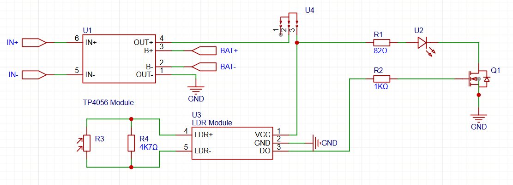

# Vintage-Night-Lamp
I'm making a nigh lamp that automaticly turn on when the room is dark, with a gothic and vintage style ornament. Using the LDR Module, rechargeable battery and market available candle light I combine this

### Schematic

To detect the light intensity, I use the LDR Module to simplfy the connection. Paralel to the LDR I also connect a 4K7Ω resistor to make the LDR More sensitif to the dark light, because I want the light to be on when it's really dark.

The Digital Output of the module than can be connected to a mosfet, which I use the LRZ44N N-Channel Mosfet and connect it to the LED.

For the LED, I use a candle LED to mimic a moving candle light. I replace the battery holder from the Light, and connect it to the Mosfet, and the output of the TP4056 Battery Charger Module.

Then for the enclosure I 3D printed a vintage type light holder, that I can hang in the wall

